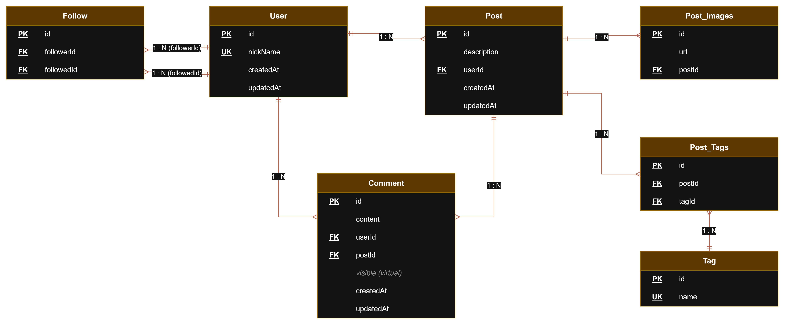

# DER

El archivo editable está en `DER.drawio` (se abre con draw.io / app.diagrams.net).

## Tablas

- **User**: id, nickName (único)
- **Post**: id, description, userId
- **Post_Images**: id, url, postId
- **Comment**: id, content, userId, postId, visible (virtual)
- **Tag**: id, name (único)
- **Post_Tags**: id, postId, tagId (tabla intermedia Post - Tag)
- **Follow**: id, followerId, followedId (bonus, tabla intermedia User - User)

Todas tienen createdAt y updatedAt. La fecha del post y del comentario es el createdAt.

## Relaciones

- User 1 - N Post
- User 1 - N Comment
- Post 1 - N Comment
- Post 1 - N Post_Images
- Post N - M Tag (con Post_Tags)
- User N - M User (con Follow)

## Algunas decisiones

- Las tablas intermedias tienen su propio id y un índice único en el par de FK para que no se repita la misma relación (igual que ProductoProveedor en el ejemplo de clase).
- `visible` no se guarda en la base: es un atributo virtual que compara el createdAt con la cantidad de meses del `.env` (COMMENT_MAX_MONTHS).
- Si se borra un post se borran sus imágenes, comentarios y tags asignados (CASCADE). Si se borra un usuario se borran sus posts, comentarios y seguidores.
